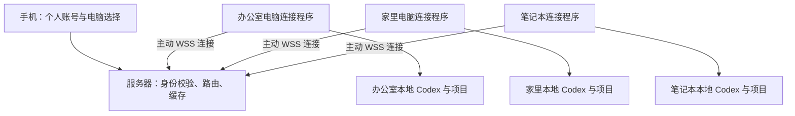

# Codex 随行：产品化与多电脑方案

日期：2026-10-23。状态：个人账号下的多电脑管理已实施并上线；公开多用户、注册与收费仍是后续方案。

本轮交付：手机切换电脑、独立配对、设备改名与解绑、按电脑隔离项目/会话/缓存/任务、Windows 登录自启和可转交的接入文档。25 项测试通过，一台实体电脑真实续聊及第二个模拟连接的公网流程已验收；第二台实体电脑由用户转交文档后接入。

## 1. 推荐方向

做成“手机上的多电脑 Codex 会话管理与续聊工具”：一个网站、每位用户自己的账号、每台电脑一个连接程序。继续使用用户电脑里的 Codex、中转站和项目文件，模型调用费用由用户原有渠道承担。

先服务本人多电脑，再邀请少量用户使用，最后补齐公开注册与收费。先验证续聊是否可靠，再扩展产品功能。

| 方案 | 优点 | 成本与限制 | 建议 |
|---|---|---|---|
| 托管网站 + 本地连接程序 | 手机统一入口，保留本地项目和模型配置，适合订阅服务 | 必须做好用户与电脑隔离，维护客户端兼容性 | 主线 |
| 每位客户单独私有部署 | 数据边界清晰，便于企业试用 | 每客户一套部署与运维，升级成本高 | 后续企业选项 |
| 把 Codex 和项目都移到云端 | 执行环境集中，个人电脑无需持续开机 | 项目、凭据与运行环境都要迁移，改变目前使用方式 | 暂不采用 |

## 2. 已完成的多电脑基础与后续改动

目前是一个可用的个人原型，不能通过多发几个账号直接变成多人产品。

| 位置 | 当前行为 | 目标行为 |
|---|---|---|
| `src/server.mjs` | 一个个人账号，已按设备保存连接和运行状态 | 增加真正的多用户登录与账号生命周期 |
| `src/store.mjs` | 已按 `ownerId + deviceId` 隔离同步、历史与指令 | 多用户上线前验证所有账号边界与数据删除 |
| `src/agent.mjs` | 已有独立设备身份、凭据、配对及撤销 | 补齐面向普通用户的安装、诊断与升级 |
| `public/app.js` | 已支持选电脑和独立项目、会话、草稿与连接状态 | 增加账号、邀请、套餐与帮助入口 |
| 本地读取适配层 | 直接读取本地索引与日志 | 增加兼容性检查和适配版本；不支持时清楚提示 |

会话列表包含项目、置顶、无项目、归档等语义。产品版本也继续只显示用户输入和 Codex 最终回复。

## 3. 用户怎么用

1. 在网站创建账号，内测阶段使用邀请链接。
2. 在电脑安装连接程序，输入网站生成的一次性配对码，或通过手机扫描电脑显示的配对码并确认。
3. 给电脑取名，例如“办公室”“家里台式机”“笔记本”。
4. 手机登录同一账号，顶部切换电脑，再进入项目和会话。
5. 电脑在线时查看最新历史并续聊；离线时显示最后同步时间，阅读已经缓存的内容。

配对码建议有效期 5 分钟、单次使用、失败限流。配对成功后签发独立设备凭据；电脑名只是显示名称，身份用随机设备 ID。用户可以随时解绑设备并撤销凭据。

手机与电脑不需要同一个 Wi-Fi。电脑需要开机、联网，并运行连接程序；把网页放服务器上不会让已经关机的电脑继续执行。

## 4. 多电脑改造设计

### 身份、数据与路由

- 所有项目、会话、历史、指令、审批、同步时间都归属 `userId + deviceId`；会话唯一键包含设备 ID，不能仅用 threadId。
- 用户身份由登录会话确定；服务端检查设备归属，不能相信前端传入的 userId。
- 用设备连接表替换单个 `agent`；一个设备只允许一个当前有效连接。重连时使旧连接失效，旧连接的延迟回复不能影响新连接。
- 读取、发送、停止、审批和事件订阅都带设备范围；设备 A 同步不得覆盖设备 B 的缓存，用户 A 不能读取或操作用户 B 的设备。
- 指令编号和幂等记录绑定用户、设备与会话；超时显示“结果待确认”，不盲目自动重发。

已实现接口：`GET /api/devices`、`GET /api/devices/:deviceId/threads`、设备范围内的详情、发送、停止、审批与事件接口，以及配对和解绑接口。多账号接口仍需另行开发。

### 手机交互

- 顶部电脑选择器显示名称、在线状态、最后同步时间，并记住上次选择。
- 对话页持续显示当前电脑名；发送前由界面明确展示目标电脑。
- 切换电脑后重建事件订阅，丢弃上一台电脑的延迟请求结果，避免串列表或误发。
- 项目折叠、搜索和最近打开的会话按电脑分别保存。
- 离线电脑可以查看缓存；发送、停止与审批禁用，不暂存等待执行的指令。
- 保持现有 writer 锁边界：桌面占用会话时提示忙碌，不强制抢占。默认只管理本连接程序启动的任务。

### 旧数据迁移

将现有管理员作为首位用户、现有电脑作为首台设备；为现有缓存补上归属字段，保留登录入口和历史。迁移前备份，校验记录数量及归属后再切换。给旧连接签发专属凭据，再撤销旧共享令牌；不要求手工重新搬运会话。

## 5. 面向别人使用必须补齐的功能

| 模块 | 首次多人内测要求 |
|---|---|
| 账号 | 独立账号与密码、邀请注册、退出、找回或管理员重置；取消共享管理员登录 |
| 设备 | 绑定、命名、解绑、撤销凭据、在线状态、版本诊断 |
| 权限 | 每用户只能看到自己的设备；设备可切只读；发送与审批策略在绑定时明确说明 |
| 数据 | 列表缓存、历史按需读取；说明服务器缓存范围；支持删除缓存与账号数据 |
| 客户端 | Windows 安装包或便携版、托盘、自启、退出、日志脱敏、更新与回退 |
| 运维 | 备份恢复、连接与错误监控、容量限制；运行日志不记录口令和完整对话 |
| 兼容性 | 列出经过测试的 Codex 版本；升级前检查读取与执行协议，失败时提供明确状态 |

中转站密钥继续保留在用户电脑。平台管理自己的登录和设备绑定，不依赖用户使用官方账号。内测先覆盖 Windows，后续根据真实需求增加 macOS / Linux。

初期可以保留 Node.js + SQLite，在现有单实例上增加归属字段与迁移。出现多服务实例或明显写入竞争后再迁移 PostgreSQL；目前无需微服务或 Kubernetes。

## 6. 分期与验收

| 阶段 | 交付范围 | 验收重点 |
|---|---|---|
| A：本人多电脑 | 一个账号绑定多台电脑、设备切换、独立缓存和路由 | 至少两台实体电脑同时连接；相同会话 ID 不冲突；切换不串数据；掉线不误发 |
| B：邀请制产品 | 多账号、配对、设备管理、客户端、备份恢复 | 两名用户各两台电脑；跨用户读取、发送、审批、事件订阅均被拒绝；验证解绑立即失效 |
| C：公开服务 | 注册找回、套餐额度、付费开通、帮助与反馈 | 首次使用无需开发者协助；限额正确；升级和恢复有演练记录 |

每阶段保留当前个人入口作为回退路径。A 阶段先做数据和路由，再做切换界面；不能只在页面加下拉框。B 阶段上线前必须完成接口越权与事件隔离测试。

暂不承诺跨电脑迁移运行中的会话：切换电脑仅查看和操作该电脑原有的会话。跨电脑迁移还涉及项目文件、依赖和凭据，需要另立需求。

## 7. 收费建议与下一步

建议按账号订阅，结合可绑定设备数区分套餐；私有部署单独报价。模型费用继续由用户自己的模型渠道支付，平台收取会话连接、管理与托管服务费用。具体价格通过内测用户反馈确定。

下一步将 `CONNECT-ANOTHER-COMPUTER.md` 交给第二台电脑的 Codex，在网页生成配对码并完成第二台实体电脑验收；A 阶段的程序、部署与模拟验证已完成。之后可在同一套设备隔离基础上扩展 B 阶段，公开多用户上线前需要独立账号及越权验证。
